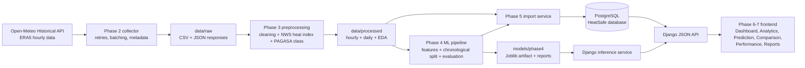

# HeatSafe System Architecture

## Overview

HeatSafe is a local-first Django application backed by PostgreSQL. The data pipeline collects modeled historical weather data, transforms it into heat-index datasets, trains a leakage-aware next-day model, imports analytical records into PostgreSQL, and exposes them through JSON endpoints to a responsive browser frontend.

## Runtime flow

1. The browser requests a page from Django.
2. The page loads `static/js/app.js` and calls the relevant `/api/` endpoint.
3. Django reads validated filters and retrieves records through the ORM.
4. Prediction generation loads the saved Joblib model and stores predictions; it does not retrain the model.
5. The frontend renders actual API values, native SVG charts, loading states, or explicit empty/error states.

## Repository layers

| Layer | Main paths | Responsibility |
|---|---|---|
| Collection | `data_pipeline/collection/`, `scripts/collect_historical_weather.py` | Open-Meteo requests, retries, batching, raw files, metadata |
| Preprocessing | `data_pipeline/preprocessing/` | Cleaning, validation, heat index, PAGASA categories, daily aggregation |
| Analysis | `data_pipeline/analysis/` | EDA charts and findings |
| Machine learning | `data_pipeline/ml/`, `scripts/train_heat_index_model.py` | Features, chronological splits, training, evaluation, inference |
| Backend | `apps/weather/`, `config/` | Models, import services, JSON endpoints, security settings |
| Frontend | `templates/core/`, `static/css/`, `static/js/` | Six responsive pages and browser interaction |
| Verification | `tests/`, `apps/*/tests.py` | Unit, preprocessing, ML, API, database, CSRF, and route tests |

## Data boundaries

- `data/raw/` contains source API responses and raw hourly CSV files.
- `data/processed/` contains derived analytical files and reports.
- `models/phase4/` contains the saved model artifact.
- PostgreSQL is the runtime source for the web dashboard and API.
- `.env` contains local secrets and is never intended for version control.
